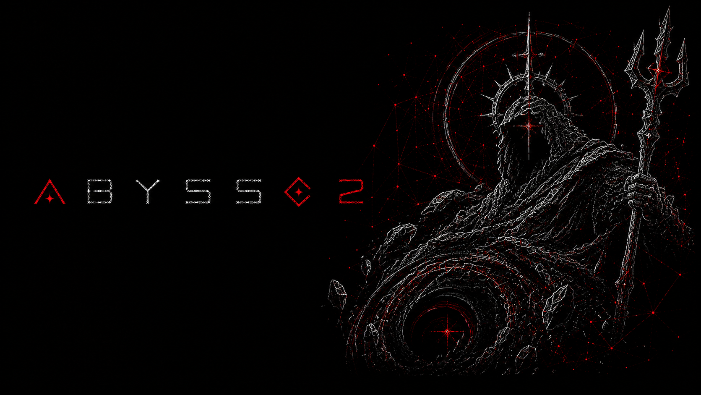

# AbyssC2

> **Work in Progress** — not ready for production use.

Abyss is a command-and-control framework written in Go and c++. It consists of a teamserver, an operator CLI client, and a Windows agent written in c++
